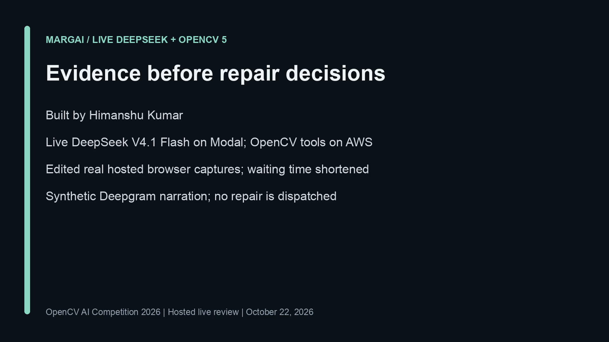
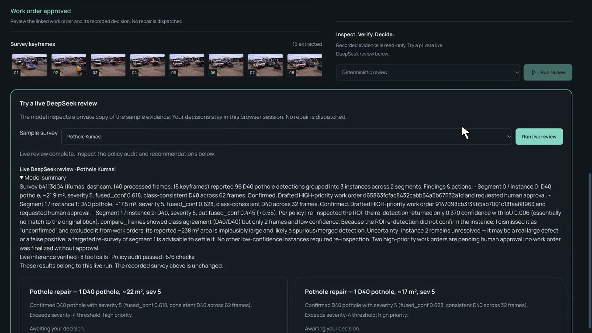

# Submitted video verification — 26 October 2026

Saved video: https://youtu.be/yJ_DOt6JkOA. The existing submission MP4 was
inspected locally; this is a verification of the existing recording, not a new render.
Its recorded total duration is 194.601 seconds (under five minutes); OpenCV
reports 5,837 video frames at 30 fps, or 194.567 seconds of video.

The opening names **Himanshu Kumar**, matching the sole member shown on the
current Devpost team page. It is a name credit with synthetic narration, not
on-camera footage of the person. The official requirement says the video must
“show the team”; whether a name credit satisfies that wording is a judging
interpretation. No genuine on-camera clip was available in the inspected assets.

At 52 seconds, the video shows the recorded completed review: eight tool calls,
six of six policy checks and draft work orders. This results scene starts at
47.28 seconds in the saved timeline, within the first minute. These are recorded
results; no new paid inference was run for this verification.

